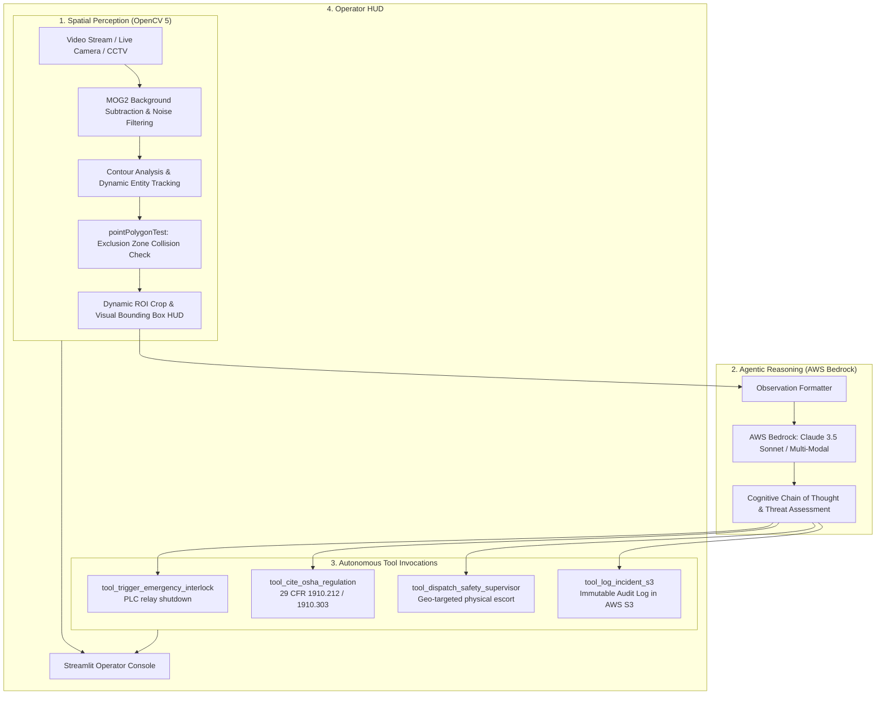

# SafeSight AI 🛡️
### Autonomous Physical Site Safety Supervisor Agent
**OpenCV AI Competition 2026 (Powered by AWS) — Agentic Vision Track**

[](https://opencv.org/)
[](https://aws.amazon.com/bedrock/)
[](https://streamlit.io/)
[](LICENSE)

---

## 📌 Executive Summary
Every year, over 2.8 million nonfatal workplace injuries occur in industrial environments, costing global industry upwards of \$170 billion. Traditional passive CCTV and rule-based CV systems only record incidents or sound nuisance beepers—they do **not** understand context, reason across regulatory safety codes, or autonomously mitigate hazards.

**SafeSight AI** is an end-to-end **Agentic Vision System** that bridges high-speed spatial perception (**OpenCV 5**) with autonomous reasoning and tool execution (**AWS Bedrock**). It transforms video feeds into an intelligent site supervisor that spots safety violations, evaluates OSHA mandates in real time, and executes automated mitigations (interlock trip signals, supervisor dispatching, and S3 compliance logging).

---

## 🏗️ System Architecture



---

## 🚀 Key Features

1. **Substantive OpenCV 5 Core**:
   - `cv2.createBackgroundSubtractorMOG2` for real-time foreground motion segmentation.
   - Morphological opening and dilation for visual noise suppression.
   - `cv2.pointPolygonTest` for ultra-fast spatial containment checking against complex geometric hazard exclusion zones.
   - Dynamic HUD rendering with translucent risk alpha blending (`cv2.addWeighted`).
   - Automated Region-of-Interest (ROI) cropping and base64 serialization.

2. **Agentic Vision & Multimodal Reasoning (AWS Bedrock)**:
   - Reasons over visual observations, trajectory speeds, and zone designations.
   - Dynamic tool dispatch: decides when to trigger emergency hardware stop relays vs when to issue an audible reminder.
   - Automated citation of regulatory standards (OSHA 29 CFR 1910 General Industry).

3. **Cloud & Enterprise Ready (AWS Ecosystem)**:
   - **AWS Bedrock**: Foundation model intelligence.
   - **AWS S3**: Automated compliance audit logs generated in standard JSON schema.
   - **Dual-Mode Execution**: Live AWS execution with automatic graceful fallback to local agent simulator for zero-friction evaluation.

---

## ⚡ Quickstart

### 1. Clone & Set Up Environment
```bash
git clone https://github.com/your-username/safesight-ai.git
cd safesight-ai

# Activate virtual environment
python3 -m venv .venv
source .venv/bin/activate
pip install -r requirements.txt
```

### 2. Generate Synthetic Demo Assets
```bash
python3 scripts/generate_sample_assets.py
```

### 3. Launch the Control Center
```bash
streamlit run app.py
```
Open your browser to `http://localhost:8501`.

---

## 📊 Live Demo Workflow
1. Select **Synthetic Factory Floor (Built-in Demo)** from the sidebar.
2. Click **▶️ Start Simulation Loop**.
3. Watch OpenCV 5 track the worker moving across the floor.
4. When the worker breaches the **Robot Arm Exclusion Zone**, observe:
   - OpenCV 5 detects boundary breach via `pointPolygonTest` and locks the target ROI.
   - AWS Bedrock launches cognitive reasoning trace.
   - Agent autonomously cites **OSHA 29 CFR 1910.212**, dispatches **Unit 4 Response Team**, triggers an **Emergency Interlock Relay**, and commits the incident audit log to **AWS S3**.
